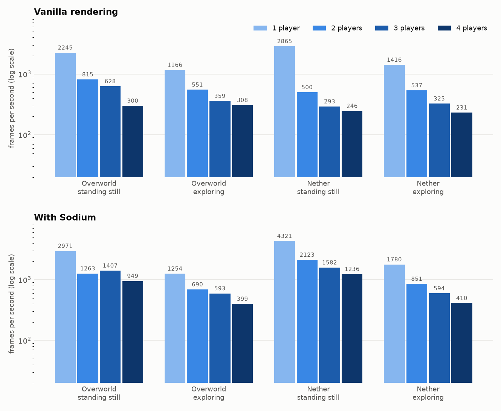

  

<h1 align="center">Couchcraft Omega</h1>

<strong>An enhanced fork of <a href="https://github.com/zortos293/Couchcraft">Couchcraft</a>: real split-screen co-op for Minecraft Java. One game, one window, up to four players.</strong>

  
  
  
  

  
  
  

  <a href="#whats-different-in-omega">What's new</a> ·
  <a href="#get-couchcraft-omega">Download</a> ·
  <a href="#play">Play</a> ·
  <a href="#inside-the-mod">Features</a> ·
  <a href="#performance">Performance</a> ·
  <a href="#documentation">Documentation</a>

  

<em>Four players, one Minecraft window. A real in-game capture, not a mockup.</em>

I got tired of co-op mods that start a second copy of the game, tile two windows, and fall over the moment
something goes wrong. So I built split screen into the game itself. Couchcraft runs every player inside **one
Minecraft client**: one process, one window, one world. Plug in a controller, press START, and the screen splits,
like the console editions used to.

> [!NOTE]
> There is no second launcher, no second client and no second window. Each extra player is a real player on your
> world's built-in server, with their own camera, HUD, menus, inventory and progress, all inside the same game.

> [!IMPORTANT]
> Couchcraft is a client mod for **Minecraft Java 26.3** on **Fabric Loader**. You don't need Fabric API. Extra
> players can join any singleplayer world, including one you've opened to LAN. They can't join online servers,
> because every player there needs their own Minecraft account.

> [!WARNING]
> This is an early release, tested with up to four players. Sodium is **experimental** (see Performance below) and Iris doesn't
> work. Every extra player renders the world again, so lower your render distance if the frame rate drops.

> [!NOTE]
> **Couchcraft Omega is an enhanced fork** of [Couchcraft](https://github.com/zortos293/Couchcraft) by
> [Zortos](https://x.com/Zortosdev), which does all the hard work of single-client split screen. Omega keeps that
> code and its MIT licence and adds the features below. Omega has its own version numbers; 0.2.0 is based on
> Couchcraft 0.2.0. It installs in place of Couchcraft (it declares that it
> `provides` `couchcraft`, so mods that depend on Couchcraft keep working) and must not be installed together
> with it. Changes that fit upstream are also offered back to the original project.

## What's different in Omega

- **Distant Horizons support.** Distant Horizons 3.3.4 works in split screen: every view gets full detail around its
  own player, and lighting and fog are right per dimension, including the Nether. Only active when Distant Horizons
  is installed. [Details](docs/DISTANT-HORIZONS.md)
- **Shift and Ctrl on the controller.** In menus, hold **LB** for Shift and **RB** for Ctrl, for the keyboard
  shortcuts of vanilla and other mods (inventory sorting, "move all matching" and so on).
- **A controller button map.** Hold **BACK** to see a pixel-art controller with a line from every button to what it
  does. Players can rename labels, and mods can add their own through an API. [Details](docs/BUTTON-MAP.md)
- **Sodium (experimental).** Couchcraft refused to start with Sodium installed. Omega no longer blocks it, and it
  was 1.1× to 5.4× faster than vanilla rendering in our benchmark. Iris is still blocked.
  [Numbers](docs/BENCHMARKS.md)
- Planned: radial menus for the hotbar and quick actions, more than four players, an on-screen keyboard for chat and
  signs, aim assist.

## Get Couchcraft Omega

1. Install [Fabric Loader](https://fabricmc.net/use/) for Minecraft 26.3.
2. Download `couchcraft-omega-<version>.jar` from [Releases](https://github.com/Vasissualiyp/CouchcraftOmega/releases/latest).
3. Put it in your `.minecraft/mods` folder and start the game with the Fabric profile.

Any controller that SDL3 recognises works: Xbox, DualSense / DualShock, Switch Pro, 8BitDo and most others.
Minecraft already ships SDL3, so there's nothing extra to install.

## Play

1. Open a singleplayer world.
2. Plug in a controller and press **START**. The screen splits and asks *Who's playing?*
3. Pick your profile and press **A**. The profile you used last time on that controller is already selected, so
   it's usually just START, A. Player 2 spawns next to you with everything they had last time.
4. Do the same for players 3 and 4. Two players stack top and bottom (switchable to side by side); three get a
   wide top view and two below; four get a quad.
5. To leave, hold **BACK + START**. Everyone else keeps playing.

| Action | Controller |
| --- | --- |
| Move / look | Left stick (analog) / right stick |
| Jump · Drop · Pick block · Inventory | A · B · X · Y |
| Attack / Use | RT / LT |
| Hotbar | LB / RB |
| Sprint · Sneak (toggle) | L3 · R3 |
| Pause · Player list | START · BACK |
| Perspective · Swap hands | D-pad ↑ · D-pad ↓ |
| **In menus** | Stick moves a cursor, A click, X shift-click, Y right-click, B back, D-pad nudges one slot, hold LB for Shift and RB for Ctrl |
| **Button map** | Hold BACK to see what each button does (also in menus) |
| **Leave the game** | Hold BACK + START |

**Player 1** can play on keyboard and mouse, a controller, or both at once. Press **BACK** on any free
controller to make it P1's, at any time, also to switch P1 from one controller to another. Keyboard and mouse
never switch off for P1. Only P1 can use them.

| Shortcut | Does |
| --- | --- |
| <kbd>Ctrl</kbd> + <kbd>Shift</kbd> + <kbd>C</kbd> | Open the controller settings (also from the title screen) |
| <kbd>Ctrl</kbd> + <kbd>Shift</kbd> + <kbd>J</kbd> | Add a player without a controller; they can pick one up with START later |
| <kbd>Ctrl</kbd> + <kbd>Shift</kbd> + <kbd>K</kbd> | Remove the last player |
| <kbd>Ctrl</kbd> + <kbd>Shift</kbd> + <kbd>L</kbd> | Switch the two-player layout: stacked ↔ side by side |

## Inside the mod

These are captures from the game running the mod.

### Everyone gets their own menus

Each player has their own inventory, chests, pause menu and death screen, drawn in their part of the screen.
Controller players get a cursor in their own colour.

### Different worlds, same couch

Players don't have to stay together. One of you can be in the Nether while the others build in the Overworld.

### Profiles: your save comes back with you

Every player is a real player on your world, so their inventory, armour, XP, advancements, statistics and spawn
point are saved with the world, the same way as in multiplayer. Guests keep that save in a **profile**:

- When you join, pick your profile. Couchcraft remembers which controller each profile last played on and
  suggests it (★), so next time it's just START, A.
- Make a new profile from the picker, or rename one. On a controller, type with the on-screen keyboard; on a
  keyboard, just type.
- **Renaming keeps your save.** A profile has a fixed ID that never changes, and that ID is what your worlds save you
  under. Rename *Player2* to *Steve* and Steve still has Player2's diamonds.
- Each profile has its own save in every world you play, so the same profile can be in three different worlds.

Profiles live in `config/couchcraft-profiles.json`. The host plays as their own Minecraft account, as always.

### House rules

- **Pause is a vote.** The world only freezes when everyone is in a pause menu. One player checking the menu
  doesn't stop the others.
- **Every sound once.** Each player's copy of the world hears the same sounds, so Couchcraft drops the duplicates and
  plays each sound from the nearest player's point of view.
- **Leaving is personal.** When a guest picks *Save and Quit*, gets kicked, or holds BACK + START, only that guest
  leaves. When the host quits, everyone's progress is saved.
- **Guests share the cheats.** If the world has cheats on, guests can use commands too.
- **Controllers count as input.** Minecraft drops to 30 FPS, then 10, when it thinks nobody is playing. Controller
  input now counts as playing, so a couch on controllers never gets throttled.

Full settings are in [Controller settings](docs/CONTROLLER-SETTINGS.md).

## Performance

Sodium (experimental) was faster than vanilla rendering in every comparison we ran, and helps more the more players
there are. Median frames per second over three runs, 16 chunks, 1600×900:

| Players | Overworld, standing still | Nether, standing still | Overworld, exploring |
| --- | --- | --- | --- |
| 1 | 2245 → 2971 | 2865 → 4321 | 1166 → 1254 |
| 2 | 815 → 1263 | 500 → 2123 | 551 → 690 |
| 3 | 628 → 1407 | 293 → 1582 | 359 → 593 |
| 4 | 300 → 949 | 246 → 1236 | 308 → 399 |

(vanilla → Sodium.) Sodium does not smooth out the worst frames while new chunks generate with three or four
players. Distant Horizons costs a lot with several players; Sodium helps there too. Charts, setup, the Distant Horizons
runs and what was not measured are in [Benchmarks](docs/BENCHMARKS.md).

## Documentation

| Page | What is in it |
| --- | --- |
| [Controller settings](docs/CONTROLLER-SETTINGS.md) | The settings screen, controller lights and rumble, `couchcraft.json` |
| [Button map](docs/BUTTON-MAP.md) | The BACK-button diagram, overriding labels, the API for other mods |
| [Distant Horizons](docs/DISTANT-HORIZONS.md) | What the compatibility layer fixes, recommended settings, `couch-dh-compat.properties` |
| [Benchmarks](docs/BENCHMARKS.md) | Sodium and Distant Horizons frame rates for 1 to 4 players, with charts |
| [How it works](docs/HOW-IT-WORKS.md) | Per-player contexts, networking, rendering and input |
| [Development](docs/DEVELOPMENT.md) | Building from source, the scripted test session, the benchmark harness |

## Known limits

- Extra players can join singleplayer and LAN-host worlds, not online servers.
- Iris is not compatible, and Sodium is experimental. Both replace the world renderer Couchcraft creates per player.
- Every extra player renders the world again, so four players cost roughly four times the GPU work of one.
- Guests can't type in chat or on signs, because there's only one keyboard.
- In small windows, half-screen views use a smaller GUI scale so the largest menus still fit.

## Contributing

Issues and pull requests are welcome. If something breaks, open an issue with your `latest.log`, your controller
model and how many players were in the game.

## License

[MIT](LICENSE), as the original (copyright (c) 2026 Zortos for Couchcraft; additions in Couchcraft Omega are by
Vasissualiyp under the same licence). Couchcraft Omega isn't affiliated with Mojang Studios or Microsoft. Minecraft is a trademark of Mojang
Synergies AB.
