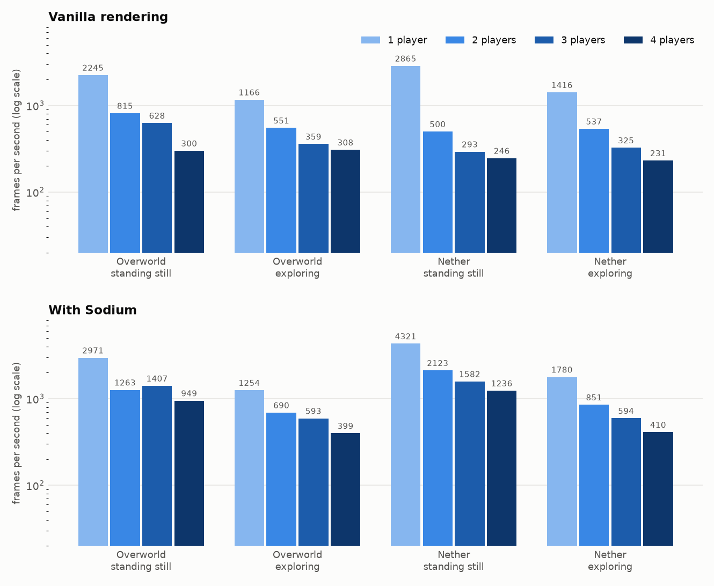
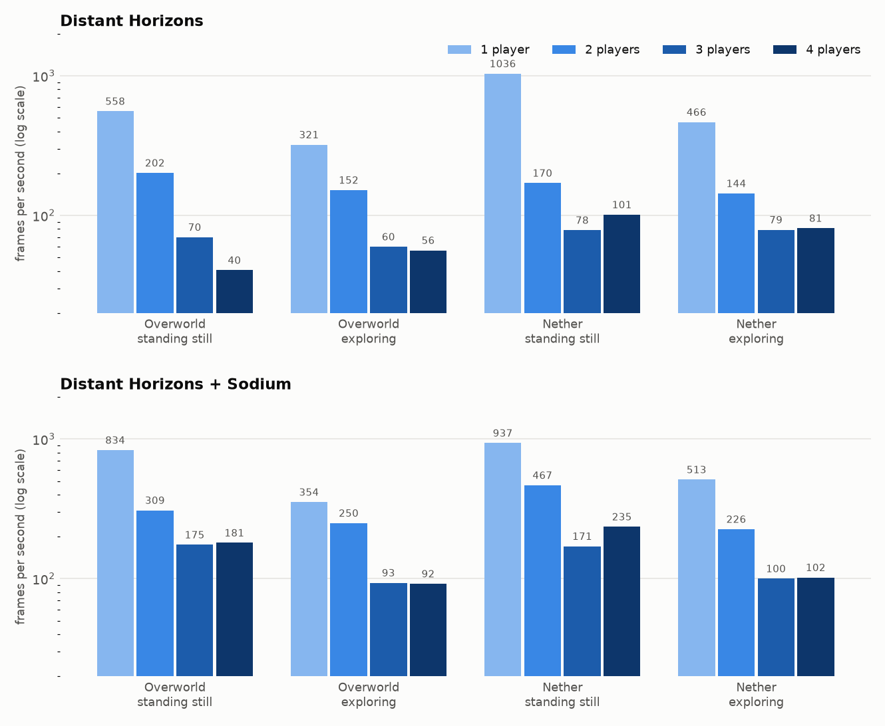

# Benchmarks: Sodium and Distant Horizons

Frame rates for 1 to 4 players with and without Sodium, and with Distant Horizons (DH). These come from the
scripted benchmark in the repo ([how to run it](DEVELOPMENT.md#benchmark)), so anyone can repeat them.

## Setup

| | |
| --- | --- |
| CPU / GPU / RAM | Intel Core i9-9900K, NVIDIA GeForce RTX 3090 (driver 595.104.02), 46 GB |
| Game | Minecraft 26.3, Fabric Loader 0.19.5, development client, 1600×900 window |
| Graphics backend | Vulkan (Minecraft's OpenGL backend could not create a context on this NixOS machine; Sodium has no code of its own for either backend and draws through Minecraft's graphics layer) |
| Render distance | 16 chunks |
| Versions | Couchcraft Omega 0.2.0, Sodium 0.9.3-beta.5, Distant Horizons 3.3.4 (settings as recommended in [Distant Horizons](DISTANT-HORIZONS.md)) |
| World | Fresh world each run. Players join one at a time, fly through ungenerated terrain, then go to the Nether |

Each cell is a mean frame rate over the stage. "Standing still" is the players idle in a loaded area; "exploring" is
flying through new terrain, so the game is also generating and meshing chunks. **Vanilla and Sodium are the median of
three runs**; DH and Sodium + DH are **one run each**. Runs of the same configuration differ by up to about 2× in a
single cell, so treat differences under about 20% as noise. Absolute numbers also moved a lot between sessions on the
same machine, so only compare numbers from this page with each other.

## Summary

- Sodium was faster than vanilla in every comparison, and the gain grows with the player count: 1.3× at one
  player and up to 3.2× at four when standing still in the Overworld, 1.5× to 5.4× in the Nether.
- While exploring, the gain is smaller (1.1× to 1.8×), because chunk generation and meshing are a bigger share of the
  frame.
- Sodium did **not** improve the worst frames while exploring with three or four players: the 1% low was about the
  same or a little lower than vanilla (for example 17 against 30 FPS with four players in the Overworld). Expect similar
  hitching when new chunks load.
- Distant Horizons is expensive with several players, because each view renders its own LODs. Sodium gives a similar
  gain there (about 1.5× to 4.5× standing still in the Overworld, 1.1× to 1.6× exploring).
- Four players with DH standing still in the Overworld ran at 40 FPS (181 with Sodium), so on this machine four
  players and DH work best with Sodium and a smaller render distance.

## Charts

Each cluster is one task; the bars inside it are 1 to 4 players (frames per second, log scale, higher is better).
The tables below have the same numbers plus the 1% lows.

With DH the Nether sometimes runs faster with 4 players than with 3. DH keeps building LODs in the background, so
how much work is left during a stage varies; I read that as noise, not a speed-up. Regenerate the charts with
`tools/bench_charts.py`.

## Vanilla and Sodium (median of three runs)

### Overworld, standing still

| Players | Vanilla | Sodium | Sodium vs vanilla | Vanilla 1% low | Sodium 1% low |
|---|---|---|---|---|---|
| 1 | 2245 | 2971 | 1.3× | 509 | 696 |
| 2 | 815 | 1263 | 1.5× | 191 | 370 |
| 3 | 628 | 1407 | 2.2× | 119 | 365 |
| 4 | 300 | 949 | 3.2× | 115 | 253 |

### Overworld, exploring (chunk generation)

| Players | Vanilla | Sodium | Sodium vs vanilla | Vanilla 1% low | Sodium 1% low |
|---|---|---|---|---|---|
| 1 | 1166 | 1254 | 1.1× | 148 | 157 |
| 2 | 551 | 690 | 1.3× | 60 | 68 |
| 3 | 359 | 593 | 1.7× | 37 | 31 |
| 4 | 308 | 399 | 1.3× | 30 | 17 |

### Nether, standing still

| Players | Vanilla | Sodium | Sodium vs vanilla | Vanilla 1% low | Sodium 1% low |
|---|---|---|---|---|---|
| 1 | 2865 | 4321 | 1.5× | 682 | 782 |
| 2 | 500 | 2123 | 4.2× | 195 | 473 |
| 3 | 293 | 1582 | 5.4× | 121 | 405 |
| 4 | 246 | 1236 | 5.0× | 110 | 301 |

### Nether, exploring (chunk generation)

| Players | Vanilla | Sodium | Sodium vs vanilla | Vanilla 1% low | Sodium 1% low |
|---|---|---|---|---|---|
| 1 | 1416 | 1780 | 1.3× | 241 | 195 |
| 2 | 537 | 851 | 1.6× | 81 | 76 |
| 3 | 325 | 594 | 1.8× | 39 | 38 |
| 4 | 231 | 410 | 1.8× | 24 | 18 |

## Distant Horizons (one run each)

### Overworld, standing still

| Players | DH | Sodium + DH | Sodium vs DH only |
|---|---|---|---|
| 1 | 558 | 834 | 1.5× |
| 2 | 202 | 309 | 1.5× |
| 3 | 70 | 175 | 2.5× |
| 4 | 40 | 181 | 4.5× |

### Overworld, exploring

| Players | DH | Sodium + DH | Sodium vs DH only |
|---|---|---|---|
| 1 | 321 | 354 | 1.1× |
| 2 | 152 | 250 | 1.6× |
| 3 | 60 | 93 | 1.6× |
| 4 | 56 | 92 | 1.6× |

### Nether, standing still

| Players | DH | Sodium + DH | Sodium vs DH only |
|---|---|---|---|
| 1 | 1036 | 937 | 0.9× |
| 2 | 170 | 467 | 2.7× |
| 3 | 78 | 171 | 2.2× |
| 4 | 101 | 235 | 2.3× |

### Nether, exploring

| Players | DH | Sodium + DH | Sodium vs DH only |
|---|---|---|---|
| 1 | 466 | 513 | 1.1× |
| 2 | 144 | 226 | 1.6× |
| 3 | 79 | 100 | 1.3× |
| 4 | 81 | 102 | 1.3× |

## Not measured

- Chunk meshing cost when blocks change, and long sessions. The stages above are short.
- OpenGL. Every number here is Vulkan.
- Mod combinations beyond Sodium and DH, and Iris (still blocked).
- More than four players.

[← Back to the README](../README.md)
